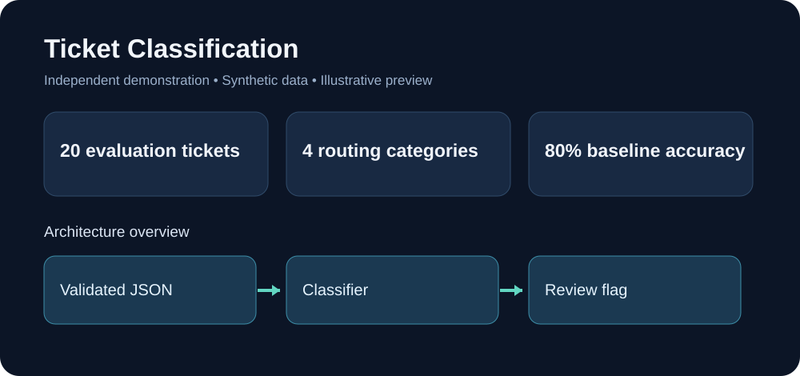
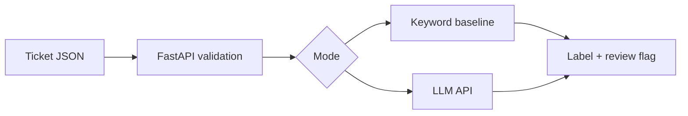

# Intelligent support-ticket classifier | FastAPI + optional LLM

Classify **synthetic** support requests into `billing`, `technical`, `account` or `general`. Returns a review flag so ambiguous cases can be escalated. Includes an offline keyword baseline and optional API-backed LLM mode.



## Architecture



## Run it

```bash
python -m venv .venv
source .venv/bin/activate
pip install -r requirements.txt
uvicorn app:app --reload
```

Open http://127.0.0.1:8000/docs and send `POST /classify`:

```json
{"text":"Please refund my last invoice","mode":"baseline"}
```

Run `python evaluate.py` to print baseline performance on the **20 synthetic test cases**. For optional LLM mode, set `OPENAI_API_KEY` securely and send `mode: llm`. Do **not** commit keys or send sensitive tickets.

## Offline example results

- Baseline accuracy: **16/20 = 80%**.
- Human review flagged: **9/20**.

These are tiny hand-authored tests, **not** production model performance. The optional live LLM mode has not been evaluated here; no production authentication or rate limiting is provided.
