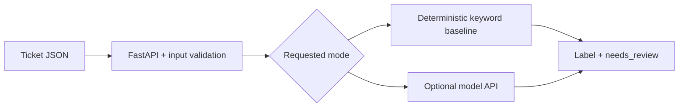

# Intelligent Support-Ticket Classifier
**Python · FastAPI · LLM API (optional) · Evaluation** | Independent portfolio project

A small REST service that labels incoming **synthetic** support tickets as `billing`, `technical`, `account`, or `general`. It returns a `needs_review` flag when the keyword baseline cannot find a unique classification. The API also supports a *separately configured* LLM-backed mode.


## Why this matters
Unstructured requests need consistent routing, but uncertain predictions should be surfaced for human review rather than silently treated as certain.

## Request flow


## Run locally
```bash
python -m venv .venv
source .venv/bin/activate
pip install -r requirements.txt
uvicorn app:app --reload
```

Visit [localhost:8000/docs](http://localhost:8000/docs) to inspect the endpoint and call `POST /classify` with:

```json
{"text": "Please refund my last invoice", "mode": "baseline"}
```

To evaluate the offline baseline, run `python evaluate.py`.

| Tiny synthetic evaluation | Result |
|---|---:|
| Ticket examples | 20 |
| Correct baseline labels | **16** |
| Baseline accuracy | **80%** |
| Flagged for review | **9** |

The four mismatches demonstrate the limitation of exact-match keywords (e.g., “crashes” does not match “crash”). These are 20 hand-authored cases, not a representative benchmark.

## Optional LLM mode
Set `OPENAI_API_KEY` in your environment (never in Git), then request `"mode": "llm"`. The response format is checked for an allowed label and boolean review field.

**Scope:** the baseline is reproducible offline; live model calls have **not** been evaluated or deployed. This demo does not include user authentication, rate limiting, full prompt-injection protection, or production monitoring. Use **no sensitive ticket data**.
